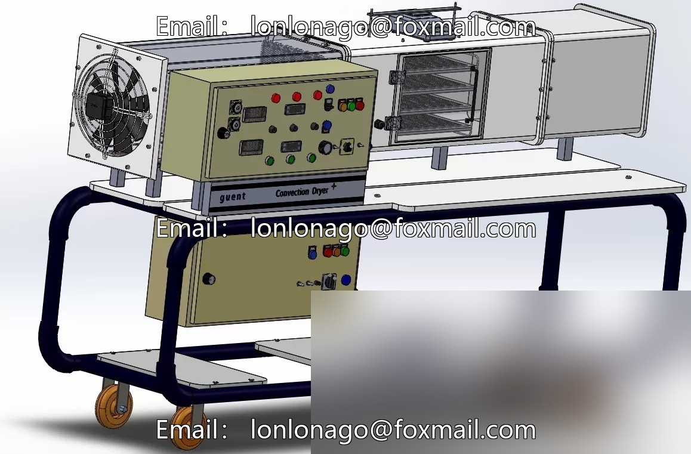
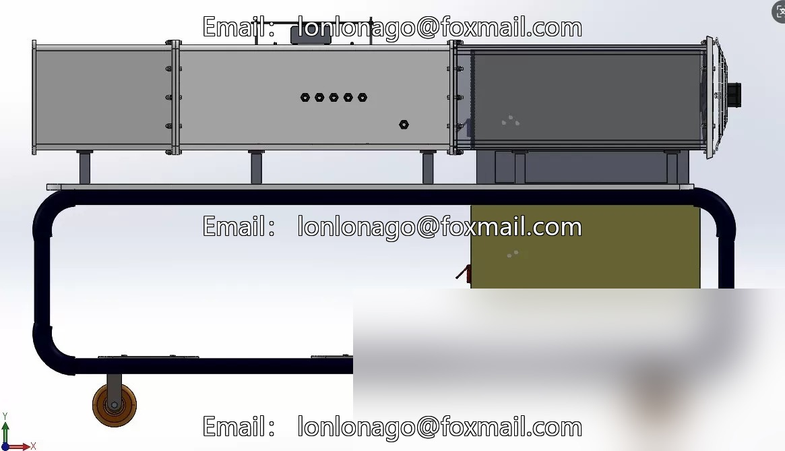
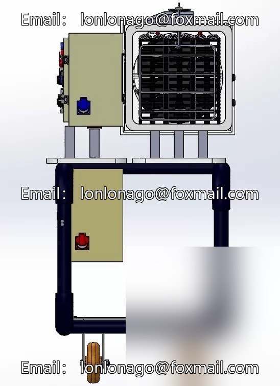

# This design is an ablatory flow drying machine, a three-dimensional model.

## Body

This design is an ablatory fluid flow drying machine, using 3D models with SoliWorks (SW) software, other software can be converted and opened, and if other software is needed, please to note it.
185-1

The design is an l aboratory pneumatic dryer with a 3D model, usable in Sol i dWorks (SW) and convertible through other software.

<!-- AI_ENRICHED -->

## Images

## Payment

Here is a pay link on Stripe ( https://buy.stripe.com/3cs8yP7sY87d0vu9AB ). Please contact me lonlonago@foxmail.com after funding $89, and I will send you a complete data files , thank you!

